<p align="center">
  
</p>

# mcu-encoder

<p align="center">
  
  
  
</p>

A small C rotary encoder library for **ESP-IDF 5.2+** and **STM32 HAL**.
Three chip drivers share one API for timestamped samples of the angle within
one turn and the total across turns, both in **radians**, with an
`absolute` flag that says whether zero means something. This library replaces
`esp-encoder`, whose ESP-IDF API it keeps; the STM32 port is new.

The repository is named `mcu-encoder`; the C API, `CONFIG_ENCODER_*`
options and forge package key remain `encoder`. The clone command below
names the ESP-IDF component directory `encoder` as well.

> **Hardware unverified.** Host tests use simulated devices and platform stubs.
> Nothing here has run on a physical chip.

[Supported hardware](#supported-hardware) · [Install](#install) ·
[Quick start](#quick-start) · [Examples](#examples) ·
[Documentation](#documentation) · [Tests](#tests)

## Supported hardware

All three drivers support both platforms. Enable only the drivers you need.

| Chip | Interface | Notes |
|---|---|---|
| **AS5047P** | SPI, mode 1 | 14-bit absolute magnetic, 16384 counts per turn; built for motors |
| **AS5600** | I2C, 0x36 | 12-bit absolute magnetic, 4096 counts per turn; one per bus |
| **AMT102-V** | quadrature A/B/X | incremental capacitive, 48–2048 PPR by DIP switch; PCNT on ESP-IDF, a timer in encoder mode on STM32 |

Wiring for every chip is in the [wiring guide](docs/hardware.md).

## Install

### ESP-IDF

Clone into your project's components directory:

```sh
git clone https://github.com/JonasAtelier/mcu-encoder components/encoder
```

Enable your chips in `idf.py menuconfig` → **Component config → Encoder
subsystem**, or add this to `sdkconfig.defaults` for the AS5047P:

```ini
CONFIG_ENCODER=y
CONFIG_ENCODER_AS5047P=y
```

The `main` component sees the library automatically. Other components declare
`REQUIRES encoder driver` in `idf_component_register()`.

### esp-forge / stm-forge

stm-forge must be at `ee921c3` or later, which builds the chip folders in
`src/`; older ones fail at link with undefined chip probes.

Add to `profiles/pkgversion`:

```make
encoder_GIT=https://github.com/JonasAtelier/mcu-encoder@stable
```

Enable the package and your chip in `configs/<target>_defconfig`:

```make
PKG_encoder         = y
ENCODER_AS5047P     = y
```

### STM32 HAL without forge

Compile every `.c` under `src/`, chip folders included, add `include/` and
`src/` to the include path, and define
`CMSIS_device_header` as your family header (`"stm32f4xx.h"` or
`"stm32f7xx.h"`), `USE_HAL_DRIVER`, and `CONFIG_ENCODER_<CHIP>=1` for each
selected chip. Enable and compile the HAL module each chip needs: I2C for
the AS5600, SPI for the AS5047P, TIM for the AMT102.

**No chip driver is enabled by default.** See the
[installation guide](docs/installation.md) for all chip options, HAL module
requirements and float logging.

## Quick start

Initialise the bus in your application, then probe the sensor and read it.
This STM32 helper assumes the passed SPI handle is already initialised in
mode 1 with 8-bit frames, and the chip select pin set up as an output:

```c
#include "as5047p.h"
#include "encoder.h"
#include "encoder_log.h"

int read_once(SPI_HandleTypeDef *spi, GPIO_TypeDef *cs_port, uint16_t cs_pin)
{
    const struct as5047p_config cfg = {
        .spi = spi, .cs_port = cs_port, .cs_pin = cs_pin,
    };
    struct encoder_dev encoder = { 0 }; /* Must start zeroed. */
    struct encoder_sample sample;
    int ret = as5047p_probe(&encoder, &cfg);
    if (ret)
        return ret;

    ret = encoder_read(&encoder, &sample);
    if (!ret)
        encoder_log_sample(&encoder, &sample);

    as5047p_remove(&encoder);
    return ret;
}
```

Call `read_once(&hspi1, GPIOA, GPIO_PIN_4)` from thread context. On ESP-IDF,
the config takes an SPI host and a CS GPIO instead; the
[AS5047P example](examples/esp/as5047p/main/main.c) shows the bus setup.
For continuous sampling, probe once, read in your loop, and remove when
finished.

- `encoder_read()` returns `angle_rad`, a `float` in `[0, 2π)` from the zero
  point, and `total_rad`, a `double` across turns, plus `t_us`. There is no
  velocity: difference two samples.
- Integer-returning API calls return **0 or a negative errno**. Use a sample
  only on success; errors leave it unchanged.
- On the absolute chips, **read faster than half a turn of travel**, or a
  revolution is missed; see [API usage](docs/usage.md#sample-fast-enough).

See [API usage](docs/usage.md) for device lifetime, bus handles, zero and
turns, timestamps, logging, and error codes.

## Examples

| Sensor | ESP-IDF | STM32 HAL |
|---|---|---|
| AS5047P | [as5047p](examples/esp/as5047p/) | [as5047p](examples/stm/as5047p/main.c) |
| AS5600 | [as5600](examples/esp/as5600/) | [as5600](examples/stm/as5600/main.c) |
| AMT102-V | [amt102](examples/esp/amt102/) | [amt102](examples/stm/amt102/main.c) |

ESP-IDF examples already locate this library through `EXTRA_COMPONENT_DIRS`.
With ESP-IDF activated, build from an example directory:

```sh
cd examples/esp/as5047p
idf.py set-target esp32 # Replace with your board's target.
idf.py build
```

STM32 examples are snippets
to integrate into your application, with clock setup, the bus or timer as
CubeMX generates it, and logging retargeting provided by you. Read the
[wiring guide](docs/hardware.md).

## Scope and limitations

The library provides a shared sample format and synchronous chip drivers.
Your application owns bus and timer setup, scheduling, and locking.

- **No velocity, no filtering:** both belong above `encoder_read()`.
- **No persistence:** zero and turn history live in RAM.
- **Software turn count** on the absolute chips: a move of half a turn or
  more between reads is miscounted.
- **AMT102 on STM32:** the library starts, reads and stops the app's timer;
  pins, encoder mode and input filter are the app's. The index needs the
  app's EXTI callback to call `amt102_index_irq()`.
- **Concurrency:** use one thread per device and bus handle, or supply a mutex.
  The HAL's own lock answers a clash with `HAL_BUSY`, which comes back as
  `-EAGAIN`.
- **STM32 timestamps:** the default clock has millisecond resolution and wraps
  after 49.7 days. Override `encoder_time_us()` if needed.

## Documentation

| Guide | Contents |
|---|---|
| [Installation](docs/installation.md) | Forge, ESP-IDF, STM32 HAL, build options and logging setup |
| [Hardware](docs/hardware.md) | Wiring and pins for each chip |
| [API usage](docs/usage.md) | Lifecycle, bus and timer handles, zero and turns, timing and errors |
| [Chip reference](docs/chips.md) | SPI frames, filters, magnet placement, quadrature, provenance |
| [Development](docs/development.md) | Platform ports, bus abstraction, adding a driver and test coverage |

Public interfaces live in [include/](include/); chip drivers and platform ports
live in [src/](src/). The [repository layout](docs/development.md#repository-layout)
maps every directory and the file-naming rule for chip folders.

## Tests

```sh
make -C test test
```

Host-only tests use stubbed HAL and ESP-IDF APIs; no embedded toolchain or
physical sensor is needed. See the [test reference](docs/development.md#tests)
for compiler requirements and coverage. Error logs during the suite are
expected: tests deliberately exercise failure paths.

## License

[MIT](LICENSE)
