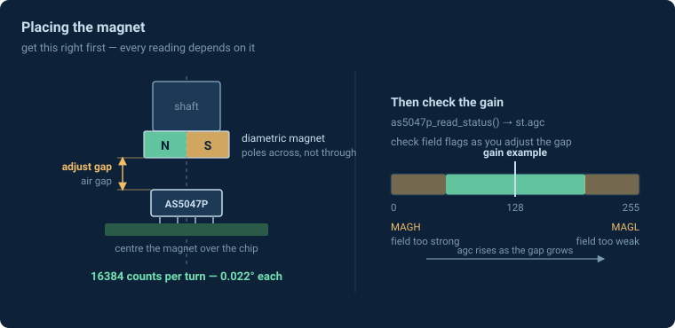
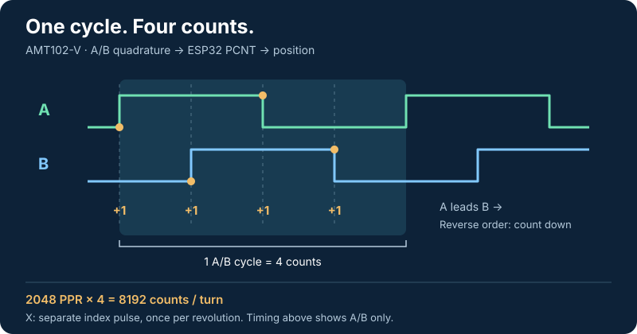

# Chip reference

[Back to README](../README.md)

Paths mentioned in this guide are relative to the repository root.

## AS5047P

16384 counts per turn, about 0.38 mrad (0.022°) each — resolution, not
accuracy. Built
for motors: specified to 28,000 rpm. Datasheet: ams AS5047P [v2-00]
2021-Jul-22, `docs/AS5047P_v2-00.pdf` (gitignored).

| Function | Does |
|---|---|
| `as5047p_probe(&encoder, &cfg)` | Attach, clear ERRFL, check DIAAGC answers sanely. The zero starts at the chip's own |
| `as5047p_remove(&encoder)` | Release the device; the bus is the app's |
| `encoder_read(&encoder, &s)` | One angle read, the software turn count kept up to date |
| `as5047p_read_counts(&encoder, &c)` | The plain 0–16383 reading, direction applied (`(16384 − count) mod 16384` with invert): no zero, no turns |
| `as5047p_read_status(&encoder, &st)` | DIAAGC and MAG: magnet field, CORDIC overflow, offset loop, AGC |

### One register read is two SPI frames

The interface is pipelined: a reply belongs to the command in the *previous*
frame (Figure 15), so every read sends the address and then a NOP to clock
the answer back. Each 16-bit frame carries even parity in bit 15 (PARC,
Figure 13; PARD, Figure 14); the driver adds it on the way out, checks it on
the way back (`-EBADMSG`), and checks the chip's error flag, EF (Figure 14):
`-EIO`. The driver treats EF as sticky until `ERRFL` is read (Figure 19:
reading ERRFL clears it), so a read that sees EF also reads `ERRFL`: that
read fails, the next one is clean. Bad parity is not EF and gets no extra
read. Commands
execute on the rising edge of CSn, so each frame is its own chip select —
which is why the bus layer has `exchange()`, a full-duplex frame, beside
`transfer()`.

There is no ID register. Probe reads `ERRFL` once and ignores it, then reads
`DIAAGC` and looks at the raw reply before decoding it: 0x0000, 0xFFFF or
0x3FFF mean MISO is stuck, `-ENXIO`. Stuck high is the case that needs the
raw look -- 0xFFFF has good parity and EF set, so decoded it would pass for
an error frame. Anything else must then decode cleanly.

### DAEC

By default the driver reads `ANGLECOM` (0x3FFF), the angle with dynamic
angle error compensation — the chip predicts out its own sampling delay,
which is what you want on a spinning shaft. `cfg.raw_angle = true` reads
`ANGLEUNC` (0x3FFE) instead (Figures 18, 23, 24). The choice applies to
`as5047p_read_counts()` too.

### Placing the magnet

<p align="center">
  
</p>

A **diametrically** magnetised magnet, centred. Check
`as5047p_read_status()`: wait for `offset_ready` (LF), and do not trust the
angle with `cordic_overflow` (COF), `magnet_too_weak` (MAGL) or
`magnet_too_strong` (MAGH) set (Figure 21). Aim `agc` for mid-range by
adjusting the air gap.

### What is not here

No ABI/UVW/PWM output configuration, no OTP programming.

### Provenance

| Claim | Status |
|---|---|
| Register addresses, frame bits, DIAAGC fields, SPI mode and clock | **From the datasheet** [v2-00], cited by figure and section in `src/as5047p/as5047p_regs.h` |
| Parity | **Verified here** over every 15-bit frame in `test/test_as5047p_math.c` |
| The driver's frames, pipelining and error paths | **Verified here**: esp-encoder's `test/esp/test_as5047p.c`, and `test/as5047p_cases.h`, a fake chip at frame level, through both ports |
| "The first frame after power-up often reports a framing error" (why probe reads ERRFL once and ignores it) | **From esp-encoder**, not found in the datasheet |
| Behaviour on a physical AS5047P | **Never checked** |

## AS5600

<p align="center">
  
</p>

4096 counts per turn, about 1.534 mrad (0.088°) each. Datasheet: ams AS5600 [v1-06]
2018-Jun-20, `docs/AS5600_DS000365_5_00.pdf` (gitignored).

| Function | Does |
|---|---|
| `as5600_probe(&encoder, bus, &cfg)` | Refuse a filter or hysteresis outside its enum, check presence at 0x36, read the angle, apply filter and hysteresis. `cfg` may be NULL |
| `as5600_remove(&encoder)` | Release the device; the bus is the app's |
| `encoder_read(&encoder, &s)` | One `ANGLE` read, the software turn count kept up to date |
| `as5600_read_counts(&encoder, &c)` | The plain 0–4095 `RAW ANGLE`, direction applied (`(4096 − count) mod 4096` with invert) |
| `as5600_read_status(&encoder, &st)` | STATUS, AGC and MAGNITUDE |

### Filter and hysteresis

`cfg.filter` picks the chip's slow filter (16×, the power-on default, down to
2×); `cfg.hysteresis` holds the output until the angle moves 1–3 counts,
which kills last-bit flicker on a still shaft (Figure 22). Probe applies
both with a read-modify-write, because the datasheet warns the other CONF
bits may hold factory settings (Figure 21, note 1). A NULL config means
16×, no hysteresis, no inversion, and on ESP-IDF 400 kHz.

### RAW ANGLE and ANGLE are different registers

`encoder_read()` uses `ANGLE`, the chip's scaled output.
`as5600_read_counts()` reads `RAW ANGLE`. With the default full-turn mapping
they agree; after OTP range programming they do not. The chip also applies a
fixed 10-LSB hysteresis at the 360° boundary of `ANGLE` ("ANGLE/RAW ANGLE
Register", p.19).

### What is not here

No OTP `BURN`, no PWM or analog output configuration.

### Provenance

| Claim | Status |
|---|---|
| Register addresses, STATUS and CONF fields, the address | **From the datasheet** [v1-06], cited by figure in `src/as5600/as5600_regs.h` |
| The driver's transfers, RMW and error paths | **Verified here**: esp-encoder's `test/esp/test_as5600.c`, and `test/as5600_cases.h`, a fake register file, through both ports |
| Behaviour on a physical AS5600 | **Never checked** |

## AMT102-V

<p align="center">
  
</p>

| Function | Does |
|---|---|
| `amt102_probe(&encoder, &cfg)` | Start counting from zero: a PCNT unit on ESP-IDF, the app's timer on the HAL |
| `amt102_remove(&encoder)` | Stop counting and release the PCNT unit, or stop the timer |
| `encoder_read(&encoder, &s)` | The count since the zero point |
| `amt102_index_hit(&encoder, &hit)` | Has the index fired since you last asked? Clears on read |
| `amt102_index_irq(&encoder)` | HAL only: the app's EXTI callback calls it for the index line |

### Set `ppr` to match the DIP switches

The resolution is a hardware setting the driver cannot read back. Whatever
the switches say (48 to 2048 PPR) must be repeated in `cfg.ppr`, or every
angle is wrong by the ratio while the counts still look sensible. `ppr = 0`
selects 2048, the factory setting. Both edges of both channels count, so
`counts_per_turn` is `ppr × 4`.

### Counting

On ESP-IDF, PCNT counts in 4x mode: each channel counts both of its own
edges, the other channel's level deciding the direction. Its hardware
counter is 16-bit; watch points at ±16384 let the PCNT driver fold each
overflow into a 32-bit accumulator, so the count only wraps after about two
billion.

On the STM32 HAL the app's timer counts in encoder mode on both inputs
(`TIM_ENCODERMODE_TI12`). The driver reads the counter on every
`encoder_read()` and adds the signed move since the last reading, modulo
the counter's range, to a 64-bit total — `amt102_counter_delta()` in
`src/amt102/amt102_math.h`. That is exact as long as the counter moves less
than half its range between reads: 32767 counts on a 16-bit timer, 4 turns
at 2048 PPR. The probe refuses an `Init.Period` other than `0xFFFF` or
`0xFFFFFFFF`, because a counter that wraps early would lose counts. The
driver never writes the counter: it starts counting from wherever it is.

### It is incremental, not absolute

Every boot reads 0 wherever the shaft is. To find the true angle, home on
the index pulse:

```c
bool index = false;

/* jog the shaft slowly with your own motion control */
while (!index) {
	amt102_index_hit(&encoder, &index);
	if (!index)
		vTaskDelay(pdMS_TO_TICKS(5));	/* HAL_Delay(5) on the HAL */
}
encoder_set_zero(&encoder);
```

Zero is captured when `encoder_set_zero()` runs, not at the index edge, so
approach slowly. `amt102_index_hit()` reads and clears a flag set by the
index interrupt — the driver's GPIO ISR on ESP-IDF, `amt102_index_irq()`
from the app's EXTI callback on the HAL; it is not a position latch. The
read and the clear happen under a lock, so an edge landing between them is
not lost: a spinlock on ESP-IDF, where the ISR may run on the other core,
and interrupts masked for those two instructions on the HAL, PRIMASK put
back as it was. On ESP-IDF, set `z_gpio` even when unwired: a zeroed config
means GPIO 0, not `GPIO_NUM_NC`.

### Noise

A noisy edge is a real count as far as the counter is concerned. On
ESP-IDF `cfg.glitch_ns` (1000 ns by default) throws away anything shorter;
on the HAL the timer's own input filter, set by the app, does that job.
Keep it well below your shortest real pulse: at 2048 PPR and 3000 rpm
adjacent edges are about 2.4 µs apart.

### What is not here

No differential input, no callbacks, no position-target interrupt; on the
HAL, no use of the timer's own index input.

### Provenance

| Claim | Status |
|---|---|
| The PCNT setup, 4x decoding, watch points, glitch filter, the index spinlock | **From esp-encoder**, unchanged; checked by its own `test/esp/test_amt102.c` against a fake PCNT |
| The 16/32-bit widening on STM32 | **Verified here**: `test/test_amt102_math.c`, and against a fake timer, wrapping both ways at 16 and 32 bits, in `test/stm/test_amt102.c` |
| PPR settings, pin names | **Not checked against a datasheet**: there is none in `docs/` |
| Behaviour on a physical AMT102 | **Never checked** |
