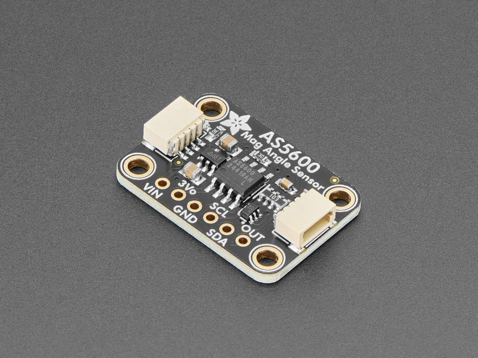

# Hardware wiring

[Back to README](../README.md)

Paths mentioned in this guide are relative to the repository root.

## Pins

On ESP-IDF any GPIO works; the GPIO numbers below are the ones the examples
in `examples/esp/` use, set at the top of each `main.c`. On STM32 the pins
are whatever the app's SPI, I2C or timer handle uses: the snippets in
`examples/stm/` take the handles as CubeMX generates them, and the chip
select and index lines are outputs and EXTI inputs the app has set up. Check
your part's alternate-function table for which pins reach which peripheral.
The bus and timer init — pins, clocks, speed, mode — is the app's.

### AS5047P — `examples/*/as5047p`

| pin | goes to | note |
|---|---|---|
| VDD | 3.3 V | the 5 V supply input of the on-chip LDO; in 3.3 V operation tie it to VDD3V3 (Figure 10) |
| VDD3V3 | VDD | the LDO output; 1 µF to ground in 5 V operation (Figure 10) |
| GND | GND | shared ground, always |
| CLK | GPIO 18 | SPI clock |
| MOSI | GPIO 23 | commands to the encoder |
| MISO | GPIO 19 | replies from the encoder |
| CSn | GPIO 5 | one per encoder on the bus; on STM32 a software chip select the driver toggles |
| Test | GND | "connect to ground" (Figure 4) |
| A, B, I, U, V, W/PWM | open | the alternate outputs are not used by this driver |

SPI mode 1 (CPOL 0, CPHA 1), MSB first, at most 10 MHz ("SPI Interface
(slave)", p.11). On ESP-IDF the driver adds the device at 4 MHz unless
`cfg.spi_hz` says otherwise; on STM32 the clock and mode are the handle's,
and the probe refuses a handle not in mode 1 with 8-bit frames. The AS5047P
executes each 16-bit command on the rising edge of CSn, so CSn must go high
between frames: a hardware NSS that stays low across transfers will not do.
Pin names and figure numbers are from `docs/AS5047P_v2-00.pdf` (gitignored).

### AS5600 — `examples/*/as5600`

| pin | goes to | note |
|---|---|---|
| VDD3V3 | 3.3 V | 3.0–3.6 V in 3.3 V mode |
| VDD5V | VDD3V3 | tie the two together in 3.3 V mode |
| GND | GND | shared ground, always |
| SDA | GPIO 21 | I2C data; consider an external pull-up (Figure 4) |
| SCL | GPIO 22 | I2C clock; consider an external pull-up (Figure 4) |
| DIR | GND | hardware direction: GND counts up clockwise, VDD counterclockwise (Figure 4) |
| OUT, PGO | open | analog/PWM output and programming option, unused |

The address is fixed at **0x36** ("I²C Interface", p.9): more than one
AS5600 needs separate buses or an I2C mux. The bus may run at up to 1 MHz.
Pin names are from `docs/AS5600_DS000365_5_00.pdf` (gitignored).

  
   Adafruit AS5600 breakout &mdash; photo <a href="https://www.adafruit.com/product/6357">Adafruit Industries</a>

### AMT102-V — `examples/*/amt102`

| pin | goes to | note |
|---|---|---|
| 5 V | regulated 5 V | **level-shift A, B and X** unless the inputs are 5 V tolerant; the encoder is a 5 V part |
| A | GPIO 18 | quadrature channel. On STM32: the timer's channel 1 input |
| B | GPIO 19 | the other channel, 90° behind. On STM32: channel 2 |
| X | GPIO 21 | index, one pulse per turn; `GPIO_NUM_NC` if you never home. On STM32: an EXTI input whose callback calls `amt102_index_irq()` |
| GND | GND | shared ground, always |
| DIP switches | — | set the resolution; `cfg.ppr` must repeat them |

The AMT102's pin names and DIP settings are not checked against a datasheet
here; there is none in `docs/`.
